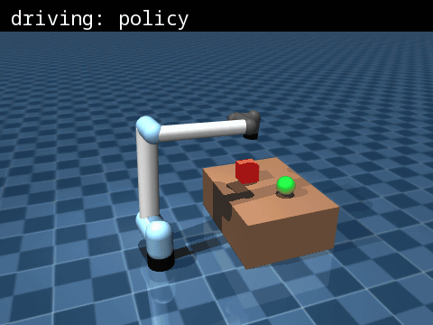
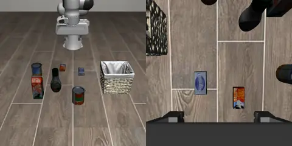
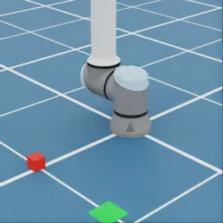
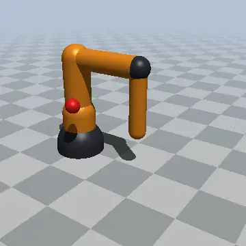
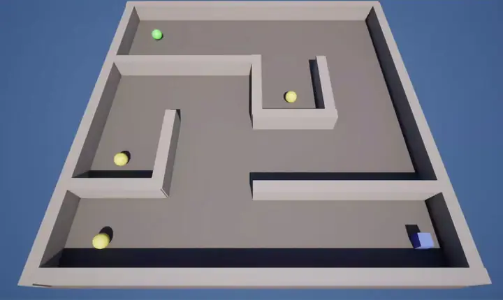
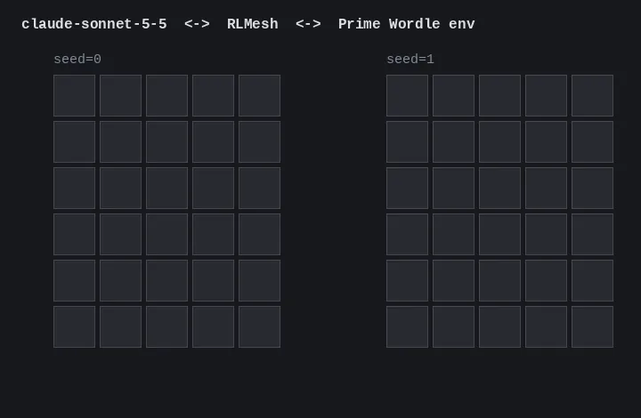

# RLMesh Examples

[RLMesh](https://github.com/ArenaX-Labs/rlmesh) connects any model to any simulator, each in its own
process, container or language. These examples run it on real robot simulators, VLAs, LLM agents, a
C++ physics engine and Unreal, and each one shows the few lines of RLMesh it takes.

## Gallery

<table>
<tr>
<td width="33%" valign="top">
<a href="python/ur10e-mujoco/"></a><br>
<a href="python/ur10e-mujoco/"><b>UR10e teleop takeover</b></a>: a 1 kHz MuJoCo arm, a policy streaming chunks, an operator who takes over, all recorded to MCAP.
</td>
<td width="33%" valign="top">
<a href="python/libero/"></a><br>
<a href="python/libero/"><b>LIBERO</b></a>: a non-Gymnasium manipulation benchmark served with cameras, state and an instruction for any VLA.
</td>
<td width="33%" valign="top">
<a href="python/isaacsim/ur10e-pick-place/"></a><br>
<a href="python/isaacsim/ur10e-pick-place/"><b>Isaac Sim pick and place</b></a>: a UR10e grasps a cube while RLMesh converts camera, pose and gripper conventions between the policy and the simulator.
</td>
</tr>
<tr>
<td width="33%" valign="top">
<a href="cpp/chrono/"></a><br>
<a href="cpp/chrono/"><b>Project Chrono</b></a>: an industrial robot simulated and served in native C++, driven by a Python model.
</td>
<td width="33%" valign="top">
<a href="unreal/"></a><br>
<a href="unreal/"><b>Unreal demo arena</b></a>: Unreal Engine game worlds as envs, each an actor component a Python policy drives.
</td>
<td width="33%" valign="top">
<a href="python/llm-agent/"></a><br>
<a href="python/llm-agent/"><b>LLM agent plays Wordle</b></a>: an LLM harness on Prime Environments Hub tasks, from Wordle to a simulated customer.
</td>
</tr>
</table>

## Start here

Three steps, two commands each, from the repository root:

1. [`hello-env`](python/hello-env/): serve a Gymnasium env and drive it with a policy.

   ```bash
   uv run --directory python/hello-env python -m rlmesh.serve --env hello_env:HelloEnv --address 127.0.0.1:7447
   uv run --directory python/hello-env run.py    # in a second terminal
   ```

2. [`byo-container`](python/byo-container/): put an env and a model in images of your own and run
   one against the other.

   ```bash
   for part in env model; do docker build -t my-$part:latest python/byo-container/$part; done
   uv run --directory python/byo-container run.py
   ```

3. [`sandbox`](python/sandbox/): let RLMesh build the container from a Gymnasium id or a Hugging
   Face EnvHub repo.

   ```bash
   uv run --directory python/sandbox run.py
   uv run --directory python/sandbox run.py hf
   ```

## I have…

| I have…                   | Start with                                                                                                                                                                                      |
| ------------------------- | ----------------------------------------------------------------------------------------------------------------------------------------------------------------------------------------------- |
| a Gymnasium env           | [`hello-env`](python/hello-env/), [`metaworld`](python/metaworld/) (cameras and an instruction), [`stack-conflict`](python/stack-conflict/) (a policy and a simulator that cannot share a venv) |
| a non-Gymnasium simulator | [`libero`](python/libero/), [`dm-control`](python/dm-control/), [`isaacsim/franka-reach`](python/isaacsim/franka-reach/) (a batched GPU vector env)                                             |
| a VLA model               | [`vla-adapters`](python/vla-adapters/) (12 model × env pairings, no glue), [`isaacsim/ur10e-pick-place`](python/isaacsim/ur10e-pick-place/), [`dm-control`](python/dm-control/) (action chunks) |
| an LLM agent              | [`llm-agent`](python/llm-agent/) (Prime Environments Hub tasks), [`coding-agent`](python/coding-agent/) (Claude writes a robot policy as code)                                                  |
| a real-time robot         | [`ur10e-mujoco`](python/ur10e-mujoco/) (1 kHz control, teleop takeover, MCAP recording)                                                                                                         |
| a game engine (Unreal)    | [`unreal`](unreal/)                                                                                                                                                                             |
| a C++ simulator           | [`cpp/chrono`](cpp/chrono/)                                                                                                                                                                     |
| a container image         | [`byo-container`](python/byo-container/), [`sandbox`](python/sandbox/)                                                                                                                          |

## Setup

Install [`uv`](https://docs.astral.sh/uv/), and Docker for the image examples. Each example has its
own `pyproject.toml`; `uv run --directory <example> ...` creates its environment on first use.

Every example pins `rlmesh==0.2.0a2`. Use the same version in a client and the image it talks to:
`git grep -n -e 0.2.0a2 -e v0.2.0-alpha.2` lists every pin to move together. A served env or model
listens on port 7447, so run one example at a time or pick another port.

## Tests

```bash
uv run pytest              # CPU tests, a minute or so
uv run pytest -m docker    # tests that build and run Docker images
mise run check             # ruff, and oxfmt for Markdown, TOML and JSON
```

The root `pyproject.toml` holds the test and lint tools; the examples do not depend on it.

## License

MIT; see [LICENSE](LICENSE).
