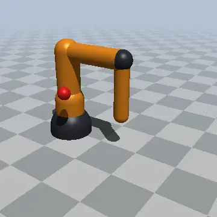

# Project Chrono in native C++

[Project Chrono](https://projectchrono.org/)'s six-axis industrial robot reaches a target, simulated
and served from C++ through the RLMesh
[C ABI](https://github.com/ArenaX-Labs/rlmesh/tree/main/crates/rlmesh-capi), with no Python in the
env. A Python model drives it like any other RLMesh env, and RLMesh adapts between them from the
tags the C++ env publishes.



## Run it

```bash
docker build -t chrono-reach:dev cpp/chrono
uv run --directory cpp/chrono run_model.py --image chrono-reach:dev
```

It prints the adapter RLMesh resolved between the env's tags and the model's spec, then the episodes
(`episodes=4 steps=37 success_rate=1.0`):

```text
observation:
  "goal" <- concat(target_pos)
  "image" <- image "image" (resize 224x224 (bilinear), uint8)
  "proprio" <- concat(eef_pos, joint_pos)
  "task" <- text "instruction"
action:
  "action/delta_eef_pos" <- model[0:3]
  clip to (-1.0, 1.0)
```

## The RLMesh part

The env is a C++ class with spaces, `reset` and `step`, served with its tags
([`src/reach_env.cpp`](src/reach_env.cpp), [`src/main.cpp`](src/main.cpp)):

```cpp
rlmesh::spaces::Space IndustrialReach::observation_space() const {
  using namespace rlmesh::spaces;
  ...
  return Dict(
      {{"image", Box(0, 255, {size, size, 3}, BoxOptions{}.with_dtype(rlmesh::DType::Uint8))},
       {"joint_pos", Box(-inf, inf, {6})},
       {"joint_vel", Box(-inf, inf, {6})},
       {"joint_torque", Box(-inf, inf, {6})},
       {"eef_pos", Box(-inf, inf, {3})},
       {"target_pos", Box(-inf, inf, {3})},
       {"instruction", Text(128)}});
}

rlmesh::EnvServer server(chrono_reach::IndustrialReach(options, std::move(renderer)),
                         rlmesh::EnvServerOptions{}
                             .with_address(describe ? ":0/env" : address)
                             .with_tags(chrono_reach::IndustrialReach::tags()));
server.serve();
```

The Python model declares the layout its checkpoint wants and never sees the env's
([`run_model.py`](run_model.py)):

```python
MODEL_SPEC = adapt.ModelSpec(
    input={
        "image": adapt.Image(adapt.IMAGE_PRIMARY, size=224),
        "proprio": adapt.Concat(adapt.EEF_POS, adapt.JOINT_POS),
        "goal": adapt.Concat("x/target_pos"),
        "task": adapt.Text(adapt.INSTRUCTION),
    },
    output=adapt.Action(adapt.Actuator(adapt.ACTION_DELTA_POS, dim=3)),
)
model = Model(make_policy(args.policy, args.seed, pace), spec=MODEL_SPEC)
```

Chrono integrates the robot at 200 Hz; each step runs 50 ms of it, and Chrono's inverse kinematics
turns the 3-D tool delta into joint setpoints. The camera is ray-traced on the CPU, so it works
headless.

## Needs

CPU and Docker. The image builds Chrono and the C ABI (from rlmesh at `RLMESH_REF`, default the
pinned tag), so the first build takes a while.

## Next

- **No Python at all:** [`src/scripted_model.cpp`](src/scripted_model.cpp) is the same policy
  against `rlmesh.hpp`'s `Model`; run `chrono_reach_model 127.0.0.1:7447 6` against
  `chrono_reach_env --address 127.0.0.1:7447`.
- **On the host:** `CHRONO_DIR=~/opt/chrono EIGEN_DIR=~/opt/eigen cpp/chrono/demo.sh --episodes 8`
  builds the C ABI (Rust toolchain and `protoc`) and this project against a Chrono 10 install (core
  plus `ChronoModels_robot`, `BUILD_DEMOS=OFF`; with a CUDA toolkit installed also
  `-DCMAKE_DISABLE_FIND_PACKAGE_Thrust=ON -DCMAKE_CUDA_COMPILER=`), serves the env and runs the
  model. Add `--view http:9000` for a live viewer.
- **Vulkan camera:** `--renderer vulkan` (built with `-DCHRONO_REACH_VULKAN=ON`, or
  `--build-arg VULKAN=ON` for the image, or `RENDERER=vulkan` for `demo.sh`) draws the same frames
  offscreen on a GPU, or on lavapipe. `ctest --test-dir cpp/chrono/build` checks it against the ray
  tracer.
- **RLMesh Managed:** the image serves on `$RLMESH_ADDRESS` under `RLMESH_HOST_IDENTITY` and drains
  on SIGTERM. To describe it before it runs, bake the envelope as a label from the built image, then
  check it:

  ```bash
  describe="$(docker run --rm chrono-reach:dev --describe)"
  docker build -t chrono-reach:dev --label dev.rlmesh.describe="$describe" cpp/chrono
  uv run --directory cpp/chrono rlmesh check-image chrono-reach:dev
  ```

  Pass the same `--image-size`, `--max-steps` and `--renderer` to `--describe` as the image serves
  with.
