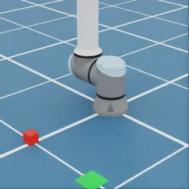

# Isaac Sim UR10e pick and place

A UR10e with a Robotiq 2F-140 gripper picks up a cube and places it on a target in Isaac Sim 6.1,
driven by a policy whose camera, pose and gripper conventions differ from the simulator's. RLMesh
converts between them; neither side has adapter code.



## Run it

```bash
docker build -t rlmesh-examples/ur10e-pick-place python/isaacsim/ur10e-pick-place
uv run --directory python/isaacsim/ur10e-pick-place rlmesh host-identity new --out env.identity \
  --address 127.0.0.1:7447 --participant env    # prints address=127.0.0.1:7447#<key>/env
RLMESH_HOST_IDENTITY="$(cat python/isaacsim/ur10e-pick-place/env.identity)" docker run --rm \
  --gpus all --memory=16g -e RLMESH_HOST_IDENTITY -p 127.0.0.1:7447:7447 rlmesh-examples/ur10e-pick-place
```

Once the container logs `RLMesh serving env`, in a second terminal:

```bash
RLMESH_ENV_ADDRESS='127.0.0.1:7447#<key>/env' uv run --directory python/isaacsim/ur10e-pick-place \
  run.py --episodes 3 --check --record recordings/demo
```

It prints each phase and the success rate; `--check` fails unless every episode succeeds, and
`--record` writes camera video and episode metrics under `recordings/demo`. `--view http` shows the
camera live at <http://localhost:8008>. The client needs no Isaac Sim or GPU.

## The RLMesh part

The env tags its fields ([`ur10e_pick_place.py`](ur10e_pick_place.py)):

```python
tags = adapt.EnvTags(
    observation={
        "image": adapt.ImageTag(adapt.IMAGE_PRIMARY),
        "joint_pos": adapt.StateTag(adapt.JOINT_POS),
        "eef_pos": adapt.StateTag(adapt.EEF_POS, frame="world"),
        "eef_quat": adapt.StateTag(adapt.EEF_ROT, encoding="quat_wxyz", frame="world"),
        "gripper": adapt.StateTag(adapt.GRIPPER_POS, range=(0.0, GRIPPER_CLOSED)),
        "cube_pos": adapt.StateTag("x/cube_pos", frame="world"),
        "target_pos": adapt.StateTag("x/target_pos", frame="world"),
        "instruction": adapt.TextTag(adapt.INSTRUCTION),
    },
    action=adapt.Action(
        adapt.Actuator(adapt.ACTION_EEF_POS, dim=3, frame="world"),
        adapt.Actuator(adapt.ACTION_GRIPPER, dim=1, range=(0.0, GRIPPER_CLOSED), clip=True),
    ),
)
```

and the policy declares its own layout: a 128x128 CHW float camera, axis-angle rotation, and the
gripper first in [-1, 1] ([`run.py`](run.py)):

```python
SPEC = adapt.ModelSpec(
    input={
        "camera": adapt.Image(
            adapt.IMAGE_PRIMARY,
            height=128,
            width=128,
            layout="chw",
            dtype="float32",
            normalize=True,
        ),
        "state": adapt.Concat(
            adapt.State(adapt.EEF_POS, frame="world"),
            adapt.State(adapt.EEF_ROT, encoding="axis_angle", frame="world"),
            adapt.State(adapt.GRIPPER_POS, range=(-1.0, 1.0)),
        ),
        "object": adapt.State("x/cube_pos", frame="world"),
        "goal": adapt.State("x/target_pos", frame="world"),
        "task": adapt.Text(adapt.INSTRUCTION),
    },
    output=adapt.Action(
        adapt.Actuator(adapt.ACTION_GRIPPER, dim=1, range=(-1.0, 1.0)),
        adapt.Actuator(adapt.ACTION_EEF_POS, dim=3, frame="world"),
    ),
)

model = Model(policy.predict, spec=SPEC, on_episode_end=policy.reset)
```

So the policy's `[-1, 0.5, 0.2, 0.325]` reaches the env as `[0.5, 0.2, 0.325, 0]`: the tool to that
world position, fingers open. The env then holds the gripper's orientation and solves the arm with
PINK inverse kinematics.

## Needs

A Linux x86_64 host with an RTX GPU and a compatible driver, Docker with the NVIDIA container
runtime, 16 GB of container memory and internet access (assets download at startup). The Dockerfile
accepts NVIDIA's EULA and privacy-consent variables; review those terms before use.

## Next

- `uv run pytest python/isaacsim/ur10e-pick-place` checks the conversions against the declarations
  and the policy's phase sequence on CPU, without Isaac Sim.
- The asset and PINK controller come from
  [NVIDIA's pick-and-place tutorial](https://docs.isaacsim.omniverse.nvidia.com/6.1.0/robot_setup_tutorials/tutorial_pickplace_example.html).
  Another robot needs its asset, kinematic model and tool transforms
  ([NVIDIA's guide](https://docs.isaacsim.omniverse.nvidia.com/6.1.0/robot_setup_tutorials/tutorial_manipulator_workflow.html#adapt-the-examples-for-an-imported-or-custom-robot));
  another policy needs only its own `ModelSpec`.
- The scripted policy does not use vision, plan collision-free paths or recover a dropped object.
  `image_size` (default 224) and `max_steps` (default 600) are the factory's params
  (`-e 'RLMESH_MAKE_KWARGS={"max_steps": 800}'`).
- [`franka-reach`](../franka-reach/): batched lanes and Isaac Lab conventions.
