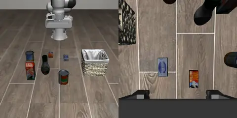

# LIBERO

A LIBERO manipulation task served as an RLMesh env: a simulator that is not Gymnasium, with fixed
initial states and bundled assets, observed as two cameras, robot state and an instruction.



## Run it

```bash
docker build -t rlmesh-examples/libero python/libero
uv run --directory python/libero run.py --image rlmesh-examples/libero
```

```text
agentview_image            (256, 256, 3)
instruction                put both the alphabet soup and the tomato sauce in the basket
robot0_eef_pos             (3,)
robot0_eef_quat            (4,)
robot0_eye_in_hand_image   (256, 256, 3)
robot0_gripper_qpos        (2,)
episodes=2 success_rate=0.00 steps=100
```

The policy is random; it checks the serving path. Add
`--make-kwargs '{"task_suite": "libero_spatial", "task_id": 0}'` for another task.

## The RLMesh part

The wrapper turns robosuite's four step results into five, and asks RLMesh for the trial number so
each episode starts from LIBERO's fixed initial states ([`libero_env.py`](libero_env.py)):

```python
def reset(self, *, seed=None, options=None):
    # reset_options tells RLMesh to supply the episode's trial number.
    trial = rlmesh.trial_index(options)
    ...
    obs = self.env.set_init_state(self.initial_states[trial % len(self.initial_states)])
    ...


def step(self, action):
    obs, reward, success, info = self.env.step(action)
    self.steps += 1
    info["is_success"] = bool(success)
    return self._obs(obs), reward, bool(success), self.steps >= self.max_steps, info
```

The factory tags the fields by role, so any VLA's spec resolves against them:

```python
class Libero(rlmesh.EnvFactory):
    tags = adapt.EnvTags(
        observation={
            "agentview_image": adapt.ImageTag(adapt.IMAGE_PRIMARY, upside_down=True),
            "robot0_eye_in_hand_image": adapt.ImageTag(adapt.IMAGE_WRIST, upside_down=True),
            "robot0_eef_pos": adapt.StateTag(adapt.EEF_POS),
            "robot0_eef_quat": adapt.StateTag(adapt.EEF_ROT, encoding="quat_xyzw"),
            "robot0_gripper_qpos": adapt.StateTag(adapt.GRIPPER_POS),
            "instruction": adapt.TextTag(adapt.INSTRUCTION),
        },
        # OSC_POSE delta control: position, axis-angle rotation, gripper.
        action=adapt.Action(
            adapt.Actuator(adapt.ACTION_DELTA_POS, dim=3),
            adapt.Actuator(adapt.ACTION_DELTA_ROT, dim=3, encoding="axis_angle"),
            adapt.Actuator(adapt.ACTION_GRIPPER, dim=1, range=(-1.0, 1.0)),
            clip=(-1.0, 1.0),
        ),
    )
    reset_options = ("trial_index",)
```

## Needs

CPU and Docker. The image renders with OSMesa and bakes in the simulator assets, so it starts
offline.

## Next

- Serve on the host: install OSMesa and a C/C++ toolchain with CMake (for `egl-probe`; with CMake 4
  also set `CMAKE_POLICY_VERSION_MINIMUM=3.5`), then
  `MUJOCO_GL=osmesa PYOPENGL_PLATFORM=osmesa uv run --directory python/libero --group sim python -m rlmesh.serve --env libero_env:Libero --address 127.0.0.1:7447`.
  Answer `N` to LIBERO's dataset path prompt; the first start downloads the assets. The client needs
  only `rlmesh`; the `sim` group holds the simulator.
- `task_suite` (default `libero_10`), `task_id` and `max_episode_steps` (upstream's budget per
  suite) are the factory's params; `rlmesh describe libero_env:Libero` in the image lists every task
  as a variant.
- This uses [`hf-libero`](https://pypi.org/project/hf-libero/), the fork LeRobot evaluates on, on
  MuJoCo 3. A matching simulator alone does not make success rates comparable: the policy, reset
  protocol and episode budget matter too.
- [`vla-adapters`](../vla-adapters/) and [`coding-agent`](../coding-agent/) drive LIBERO with a VLA
  and with Claude.
