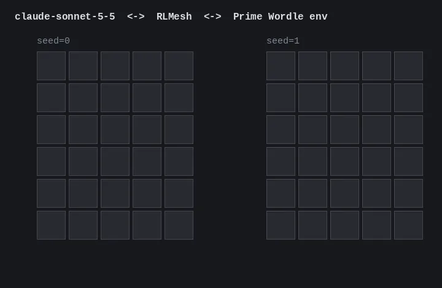

# LLM agent

An LLM agent harness playing
[Prime Environments Hub](https://app.primeintellect.ai/dashboard/environments) tasks (Wordle, math,
tool use, a simulated customer) through RLMesh: the harness is the model, the task is the env, and
one step is one assistant message.



## Run it

With Ollama and the env venvs from [Needs](#needs), serve Wordle and let a local model play it:

```bash
cd python/llm-agent
.venv-v0/bin/python serve_v0.py --env wordle --address 127.0.0.1:5555
uv run run.py 127.0.0.1:5555 -n 2    # in a second terminal, from python/llm-agent
```

It prints each episode's steps, reward and success, and writes every LLM call to
`runs/<timestamp>/transcripts/`. Seeds `0..n-1` pick the tasks, so a run reproduces.

## The RLMesh part

Observations and actions are JSON text: the env sends new chat messages and tool schemas, the model
answers with one OpenAI-style assistant message. The env side is a base class whose `reset` and
`step` wrap a task's turns ([`chat_env.py`](chat_env.py)):

```python
class ChatTaskEnv:
    observation_space = rlmesh.spaces.Text(1_000_000, min_length=1)
    action_space = rlmesh.spaces.Text(1_000_000, min_length=1)

    def reset(self, seed=None, options=None):
        self.seed = seed or 0
        turn = self.start(self.seed)
        return _observation(turn), {"task_id": self.task_id}

    def step(self, action):
        turn = self.respond(_message(action))
        if turn.rewards is None:
            return _observation(turn), 0.0, False, False, {}
        ...
        return _observation(turn), turn.reward, not turn.truncated, turn.truncated, info
```

The harness is an `rlmesh.Model` that keeps the chat per episode in RLMesh's per-episode state
([`harness.py`](harness.py)):

```python
class LLMHarness(rlmesh.Model):
    def predict(self, observation: str, context: PredictContext) -> str:
        obs = json.loads(observation)
        messages = context["state"].setdefault("messages", [])
        messages.extend(obs["messages"])
        reply, usage = self.chat(messages, obs["tools"])
        messages.append(reply)
        return json.dumps(reply)
```

and [`run.py`](run.py) is `LLMHarness(...).run(args.address, seeds=list(range(args.n)))`.

## Needs

- CPU and an OpenAI-compatible LLM server. The harness reads `OPENAI_BASE_URL` (default Ollama at
  `http://localhost:11434/v1`) and `OPENAI_API_KEY`. For Claude, set `ANTHROPIC_API_KEY` (what an
  Anthropic connection on RLMesh Managed provides) and pass `--model claude-sonnet-5-5`: the harness
  then calls Anthropic's Messages API with adaptive thinking and logs Claude's summarized thinking.

  ```bash
  ollama pull qwen3:4b && ollama serve    # gemma3:4b for color-codeword's images
  ```

- One venv per verifiers generation, since v0 and v1 cannot share an interpreter. Hub packages come
  from Prime's index (`--extra-index-url` would resolve `wordle` to an unrelated PyPI package):

  ```bash
  cd python/llm-agent
  for v in v1 v0; do
    uv venv --python 3.11 .venv-$v
    uv pip install --python .venv-$v/bin/python \
      --index https://hub.primeintellect.ai/primeintellect/simple \
      --index-strategy unsafe-first-match \
      $([ $v = v0 ] && echo --override overrides-v0.txt) -r requirements-$v.txt
  done
  ```

  `overrides-v0.txt` keeps `verifiers` at 0.1.14 for `color-codeword`.

## Next

- **Other tasks.** `serve_v0.py --env` serves a verifiers v0 environment (`wordle`, `mastermind`,
  `alphabet-sort`, `tool-test`, `color-codeword`, multimodal); `serve_v1.py --taskset` a v1 taskset
  (`primeintellect/math500`, `humaneval`, `aime25`, `gpqa`);
  `serve_v1.py --env primeintellect/tau2-bench` a tool-using agent against an LLM-simulated
  customer; `chat_env.py --task tictactoe` two seats played by one model. The final step's `info`
  holds `is_success`, `reward`, `rewards` and `task_id`.
- **Code execution is unsandboxed.** `humaneval`'s `--runtime subprocess` (and the image's
  `RUNTIME=subprocess`) runs model-written code as the server's user; use it only locally.
- **tau2-bench.** The customer simulator asks for `gpt-4.1` at `OPENAI_BASE_URL` (locally,
  `ollama cp qwen3:4b gpt-4.1`); a `PRIME_API_KEY` sends it to Prime's inference instead. Serve it
  with `--max-steps 20` (small customers often fail to hang up) and `RLMESH_NUM_ENVS=1`.
- **Budgets.** qwen3's thinking counts against `--max-tokens` (default 8192); RLMesh abandons a step
  after 300 s, so keep the budget to what your server generates in that time.
- **Docker.** [`docker/`](docker/) builds the harness and each env server as images served with
  `python -m rlmesh.serve`, configured by build args (`TASKSET`, `ENV_ID`, `RUNTIME`, `MAX_TURNS`,
  `OPENAI_BASE_URL`, `OPENAI_MODEL`) and loading their task on the first reset.
  `uv run run_docker.py --build v0 -n 1` builds both and runs them as sandboxes. On Linux, build the
  harness with `--build-arg OPENAI_BASE_URL=http://172.17.0.1:11434/v1` and start Ollama with
  `OLLAMA_HOST=0.0.0.0`. On Docker Desktop a sandbox model cannot reach a sandbox env; use
  `--local-harness`. Never bake a real `OPENAI_API_KEY` into an image: Managed injects credentials
  at run time.
- **RLMesh Managed.** Managed envs reach only a few hosts, so an env image fetches its task's data
  at build time (`env-v0.Dockerfile` does). Label each image with its describe envelope, or Managed
  starts it as an rlmesh 0.1 server, and push it as `:latest`, the tag evaluations run:

  ```bash
  img=registry.rlmesh.dev/<namespace>/llm-harness
  docker build -f docker/harness.Dockerfile --build-arg OPENAI_MODEL=claude-sonnet-5-5 -t "$img" .
  label=$(docker run --rm --entrypoint rlmesh "$img" describe harness:LLMHarness --label)
  echo "FROM $img" | docker build --label "$label" -t "${img}:latest" - && docker push "${img}:latest"
  ```

  The env is the same with `env-v0.Dockerfile` and `serve_v0:EnvironmentEnv`. Add your provider key
  under Settings → Connections, then name it on the model in the evaluation request:
  `{"models": [{"model": "<namespace>/llm-harness", "connections": ["conn_..."]}], "tasks": [{"taskId": "wordle", "env": "<namespace>/llm-env-wordle", "episodes": 3}]}`.

- **Output.** Both sides write under `$RLMESH_OUTPUT_DIR` (default `./runs/<timestamp>`):
  `transcripts/<episode_id>.jsonl` from the harness (one line per LLM call with the step, the
  episode seed (which RLMesh also records per episode), the request, the reply, its `reasoning` when
  the provider returns one, and usage; then `episode_end`) and `env/seed-<seed>.jsonl` from the env
  (one line per finished episode). The harness also prints one line per step to stderr (reply, tool
  calls, tokens, start of the thinking), which Managed shows as the model log.
