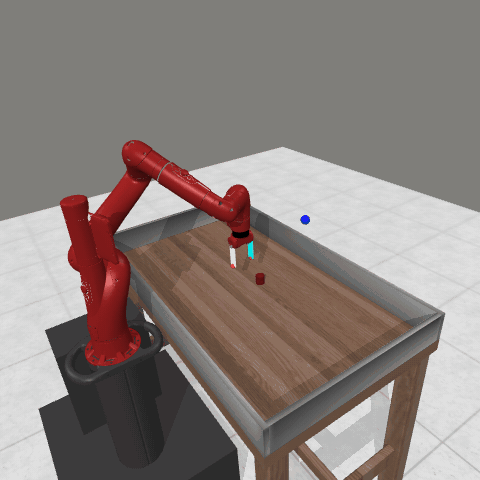

# Meta-World

A Meta-World MT1 task served with a camera image, robot state and a language instruction, the
observation a VLA expects, on top of the upstream Gymnasium env.



## Run it

```bash
docker build -t rlmesh-examples/metaworld python/metaworld
uv run --directory python/metaworld run.py --image rlmesh-examples/metaworld
```

```text
image=(256, 256, 3) state=(39,) task='Reach a goal position'
episodes=2 mean_reward=<float> steps=200
```

Add `--make-kwargs '{"env_name": "push-v3"}'` for another task. The policy is random; it checks the
serving path.

## The RLMesh part

The factory tags each observation and action field with a role, so RLMesh can adapt it for any model
that declares its own layout ([`metaworld_env.py`](metaworld_env.py)):

```python
class MetaWorld(rlmesh.EnvFactory):
    tags = adapt.EnvTags(
        observation={
            # corner2 renders with both axes inverted. Declaring it lets RLMesh
            # rotate the frame for any model that expects it upright.
            "image": adapt.ImageTag(adapt.IMAGE_PRIMARY, upside_down=True),
            "state": adapt.Split(
                adapt.Field(adapt.EEF_POS, 3, frame="world"),
                adapt.Field(adapt.GRIPPER_POS, 1),
                adapt.Field(dim=STATE_DIM - 4),
            ),
            "task": adapt.TextTag(adapt.INSTRUCTION),
        },
        action=adapt.Action(
            adapt.Actuator(adapt.ACTION_DELTA_POS, dim=3),
            adapt.Actuator(adapt.ACTION_GRIPPER, dim=1, range=(-1.0, 1.0)),
            clip=(-1.0, 1.0),
        ),
    )
```

The client opts out of adaptation to print the observation exactly as served ([`run.py`](run.py)):

```python
model = Model(predict, spec=rlmesh.NO_ADAPTER)
with SandboxEnv(f"image://{args.image}", connect_timeout_seconds=300, **params) as env:
    result = model.run(env, **run)
```

## Needs

CPU and Docker. The image renders headless with OSMesa.

## Next

- Serve on the host instead, with OSMesa installed (`libosmesa6` or `mesa-libOSMesa`):
  `MUJOCO_GL=osmesa uv run --directory python/metaworld python -m rlmesh.serve --env metaworld_env:MetaWorld --address 127.0.0.1:7447`,
  then `uv run --directory python/metaworld run.py`.
- `env_name`, `camera_name` and `image_size` are the factory's params;
  `docker run --rm rlmesh-examples/metaworld rlmesh describe metaworld_env:MetaWorld` lists them and
  the 50 task variants from [`tasks.py`](tasks.py).
- [`libero`](../libero/): a simulator that is not Gymnasium at all.
- [`vla-adapters`](../vla-adapters/): how model specs resolve against these tags.
