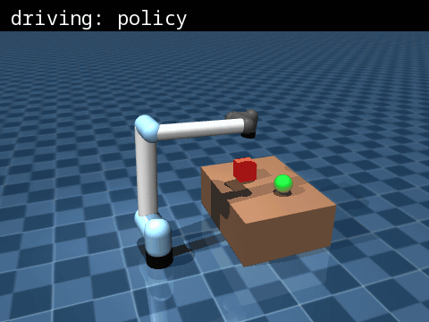

# MuJoCo UR10e with teleop takeover

A real-time session: a simulated UR10e at 1 kHz, a policy streaming action chunks, and an operator
who takes the arm over and hands it back, all recorded to MCAP.



## Run it

```bash
uv run --directory python/ur10e-mujoco run.py --seconds 10
```

The default run is headless and scripted: the operator takes over at 40% of the run, jogs two joints
and hands back at 65%. The demo then reads the recording back and prints chunk ages per lease
holder, hold ticks, misses, the takeover and hand-back as the robot saw them, and the MCAP check;
`--json` prints the full report, and the exit code is non-zero when a check fails.
`--keys interactive` lets you drive it from the terminal (`t` take over or hand back, `1`-`6` pick a
joint, `+`/`-` jog it).

## The RLMesh part

The robot declares its parts once; the edge publishes them each tick and applies what is due
([`run.py`](run.py)):

```python
"arm": parts.joints(
    UR_JOINTS,
    fields=["pos", "vel", "effort"],
    hz=CONTROL_HZ,
    command="position",
    safe=parts.Safe.STOP,
    hold_max_ms=100,
    max_action_age_ms=1000,
    limits={"pos": [-6.283, 6.283]},
),
"wrist/ft": parts.wrench(frame="tool0", hz=CONTROL_HZ),
...
due = robot.due("arm")
if due is not None and isinstance(due.value, np.ndarray):
    data.ctrl[:] = due.value
```

The policy reads joints, a 10 ms force window and the wrist camera, and returns 12 x 1 ms chunks at
100 Hz:

```python
with realtime.Policy(
    hz=args.replan_hz,
    inputs=policy_inputs(args),
    actions={"arm": arm_action(chunk=args.chunk)},
    allow=["resize", "pad"],
    session=args.address,
    name="policy",
) as policy:
    policy.bind(ROBOT)
    stats = policy.run(predict, duration=args.seconds)
```

The operator joins at `operator` priority. Acquiring the lease pre-empts the policy, whose chunks
the edge fences; releasing to the model resumes it:

```python
with realtime.Policy(
    operator_map(args), session=args.address, name="operator", priority="operator"
) as op:
    op.bind(ROBOT)
    op.acquire()
    op.send({"arm": chunk.astype(np.float32)}, op.observe())
    op.release(to="model")
```

`realtime.SessionRecorder(record, session=host)` writes every envelope as it travelled, readable by
Foxglove and the `mcap` tools.

## Needs

CPU. The wrist camera renders with EGL (`MUJOCO_GL=egl`; Mesa's llvmpipe is enough) and
`--camera off` needs no OpenGL. `--view` opens MuJoCo's viewer on a display.

## Next

- One role per terminal: `run.py robot --seconds 120` prints the session address, then
  `run.py policy --address ADDR` and `run.py operator --address ADDR --keys interactive`.
- `--operator haptic` runs the operator at 1 kHz with one-action chunks; `--replan-hz` and `--chunk`
  tune the policy; `--camera raw` sends uncompressed frames.
- The recording's topics: `/ur10e/{path}` samples, `/ur10e/arm/_applied` (what the edge dispatched
  each tick), `/ur10e/arm/_chunks`, `/_session/authority` and `/_session/bindings`;
  `rlmesh.realtime.read_recording(path)` checks and summarises it.
- [`ur10e.xml`](ur10e.xml) is derived from
  [MuJoCo Menagerie](https://github.com/google-deepmind/mujoco_menagerie)'s `universal_robots_ur10e`
  (BSD-3-Clause, [`LICENSE-ur10e`](LICENSE-ur10e)); `--model` loads another MJCF with the same joint
  names. The [real-time docs](https://github.com/ArenaX-Labs/rlmesh/blob/main/docs/realtime.md)
  cover the session model.
